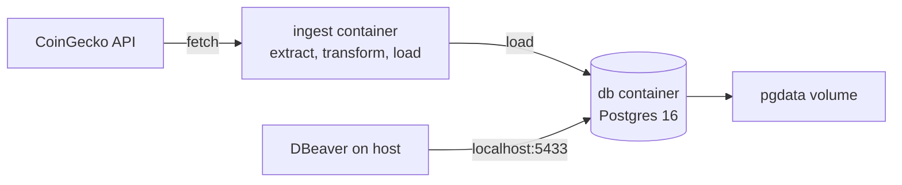

# Assignment 1: Crypto Data Ingestion with Docker Compose

A basic ETL pipeline that pulls the top 100 cryptocurrencies by market cap from the
[CoinGecko API](https://www.coingecko.com/en/api), cleans the data with Pandas, and loads it
into PostgreSQL with SQLAlchemy. The database and the ingestion script both run in Docker,
started together with one command.

## Architecture



## Pipeline steps

| Step | What happens |
| --- | --- |
| Extract | Requests the top 100 coins from CoinGecko, retrying up to 3 times if the request fails |
| Transform | Keeps 9 relevant columns, uppercases symbols, converts `last_updated` to a timestamp, drops rows with no price, removes duplicates, adds an `ingested_at` column |
| Load | Writes the result to the `coin_markets` table in the `crypto` database |

## Files

| File | Purpose |
| --- | --- |
| `ingest.py` | The pipeline. Reads the database host with `os.getenv("DB_HOST", "localhost")` |
| `Dockerfile` | Builds the ingestion image (Python 3.14, dependencies installed with uv) |
| `docker-compose.yml` | Runs two services: `db` (Postgres) and `ingest` (the script) |
| `pyproject.toml` / `uv.lock` | Dependencies and their locked versions |

## How to run

```bash
docker compose up --build
```

The `ingest` container waits for the database healthcheck, loads the data, and exits with code 0.
The `db` container keeps running.

Connect from DBeaver or pgcli with:

| Setting | Value |
| --- | --- |
| Host | localhost |
| Port | 5433 |
| Database | crypto |
| User / Password | root / root |

Postgres is exposed on port 5433 because a local Postgres instance already uses 5432.

## Proof

**1. `docker compose up --build`:** ingestion completes and the container exits with code 0


**2. `docker ps`:** `db` is healthy, `ingest` has exited cleanly


**3. `SELECT * FROM coin_markets LIMIT 5;` in DBeaver**


## Problems I hit and how I fixed them

| Problem | Cause | Fix |
| --- | --- | --- |
| `No module named 'psycopg'` | SQLAlchemy 2.1 defaults to the newer psycopg driver, but psycopg2 was installed | Named the driver in the URL: `postgresql+psycopg2://` |
| DBeaver: `password authentication failed` | A local Postgres was already on port 5432, so DBeaver reached the wrong server | Mapped the container to `5433:5432` |
| `uv` writing to the parent folder's `.venv` | `uv init` inside an existing uv project made this a workspace member | Removed it from the parent workspace so the project is standalone |
| `empty compose file` | The file was pasted but not saved | Saved it (and turned on Auto Save) |